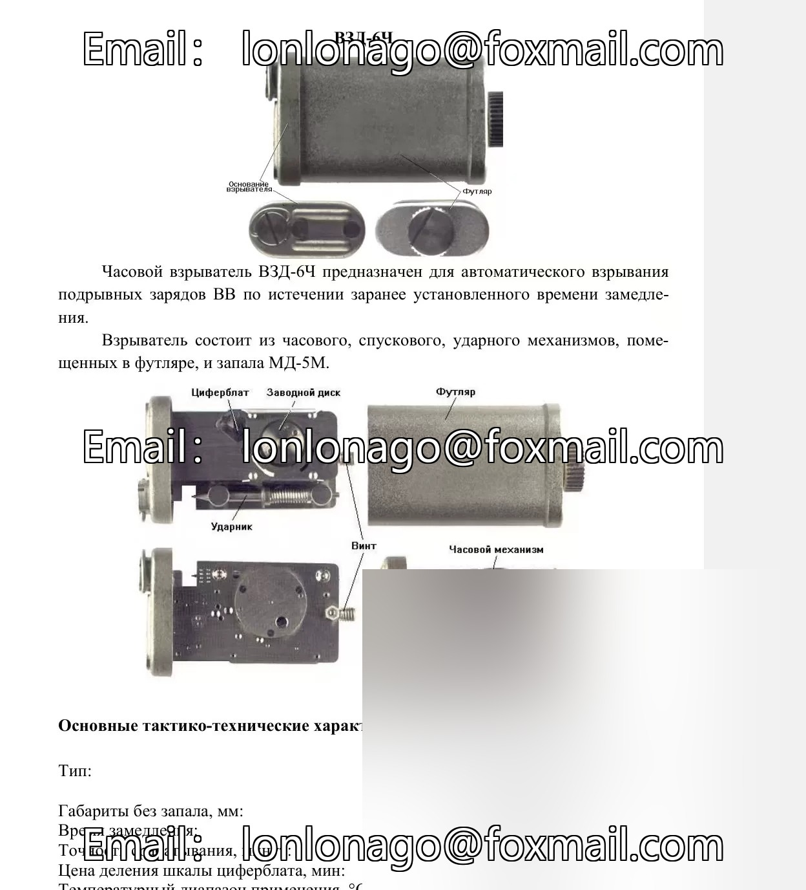
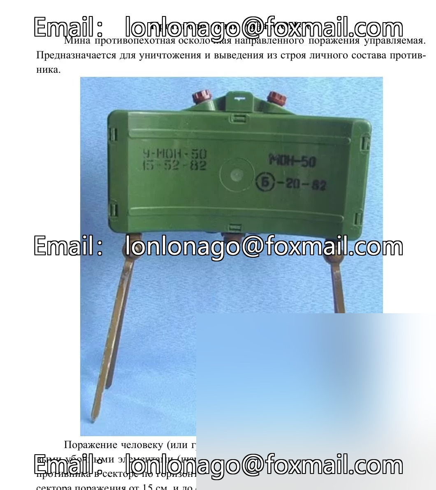
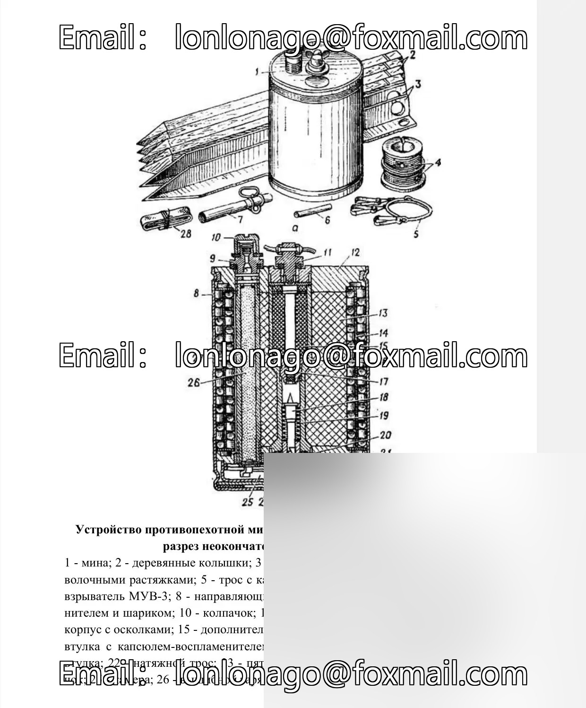
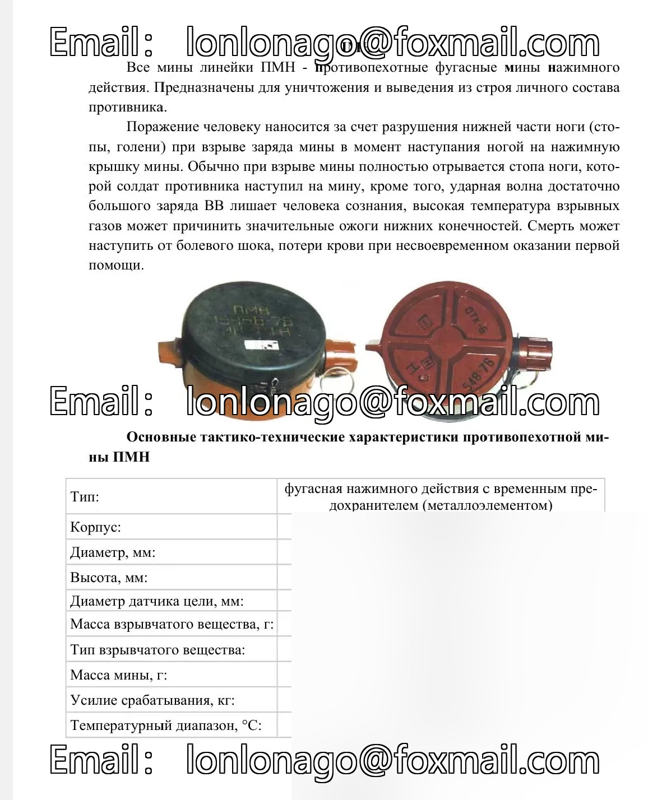
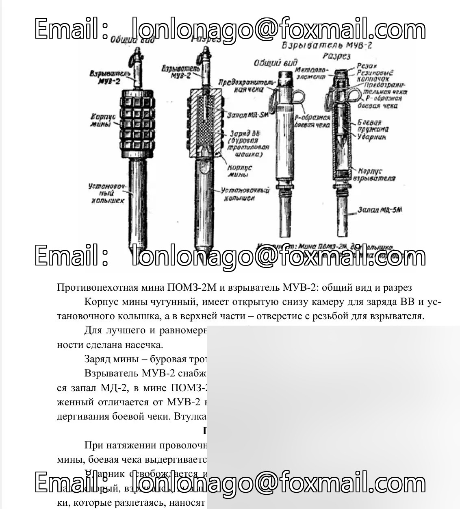

# 《Russian Federation Anti-Infantry Mine Technical Manual》

## Body

"The Russian Federation Anti-Artillery Mine Technology Manual"
The original Russian edition , compiled by KMB.
83 pages
1. Main contents
1. Classification and structure of anti-artillery mines
2. Detailed analysis of models such as VZD-6CH mechanized timing fuses, MOH-50, OZM-72, PMN, and POMZ-2M
3. Technical parameters, working principles, and usage methods
4. Suitable for learning and reference for military academies, military units, anti-terror organizations, and military enthusiasts
2. Document characteristics
Authority: Professional military technical materials with systematic and comprehensive content
Practicality: Rich details in structural diagrams, parameter tables, working principles, etc.
are copyable, and they are returned upon sale.
No shipping included, no pickup support, no price discussion.
Requirements can be discussed privately.

The manual covers Russian Federal anti-infantry mine technology: classification, structure, technical parameters, principles and usage, with specific models and training areas; it is in Russian original and spans 83 pages.

<!-- AI_ENRICHED -->

## Images

## Payment

Here is a pay link on Stripe ( https://buy.stripe.com/3cs8yP7sY87d0vu9AB ). Please contact me lonlonago@foxmail.com after funding $89, and I will send you a complete data files , thank you!

